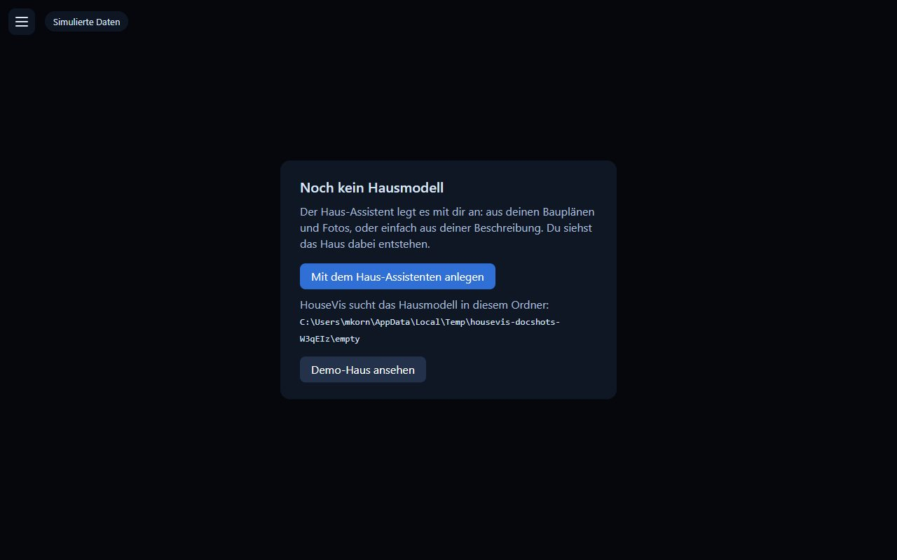
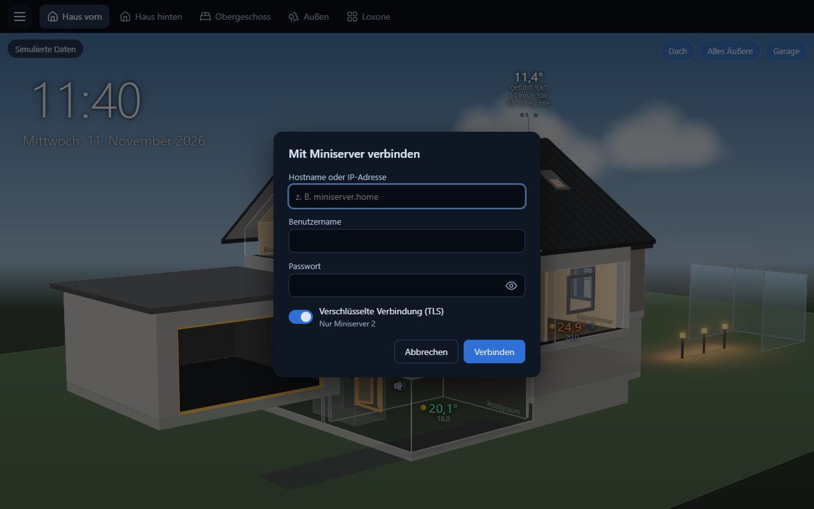

# 1 – Installation und erster Start

[← Übersicht](README.md) · [English](../en/1-install.md)

> [!IMPORTANT]
> **Während der Beta gibt es HouseVis über das Forum.** Beantrage auf
> [forum.housevis.de](https://forum.housevis.de/g/Beta-Tester) die Mitgliedschaft in der Gruppe **Beta-Tester**.
> Sobald du freigeschaltet bist, findest du den Windows-Installer und die Android-APK im Bereich
> [Beta-Programm](https://forum.housevis.de/c/beta-programm).

## Windows

1. Lade `HouseVis-Setup-<Version>.exe` von der
   [Releases-Seite](https://github.com/Grestorn/HouseVis/releases) herunter und starte es.
2. Windows warnt eventuell vor einem „unbekannten Herausgeber" (der Installer ist noch nicht
   signiert): **Weitere Informationen** → **Trotzdem ausführen**.
3. Der Installer installiert HouseVis nur für deinen Windows-Benutzer, ohne Administratorrechte.

**Update von einer älteren Version:** einfach den neuen Installer starten. Braucht die neue
Version ein neueres Format für das Hausmodell, stellt sie deine `house.json` beim ersten Start
selbst um; die alte Datei bleibt daneben erhalten (z. B. `house.v6.json`). Auch Export-Dateien
einer älteren Version lassen sich auf dem Tablet weiter einlesen.

## Erster Start

Ohne Hausmodell zeigt HouseVis den Startbildschirm:

- **Mit dem Haus-Assistenten anlegen** – das Modell in der App bauen (siehe
  [Kapitel 2](2-hausmodell.md), Weg A).
- **Anderen Ordner wählen …** – wenn du schon ein Modell hast (z. B. von Claude Code gebaut).
- **Demo-Haus ansehen** – erst mal umschauen.

Der dort angezeigte Ordner (standardmäßig `Dokumente\HouseVis`) ist der Platz deines Hausmodells.
Du kannst ihn jederzeit über Menü → **Konfigurationsordner …** ändern; die App startet dann neu.

## Mit dem Miniserver verbinden

Menü (☰ oben links) → **Mit Miniserver verbinden**:

- **Hostname oder IP-Adresse** des Miniservers, z. B. `192.168.1.10` oder sein Name im Netz.
- **Benutzername und Passwort** eines Loxone-Benutzers. Am besten ein eigener (z. B. `housevis`),
  der **alle Räume** sehen darf – HouseVis bekommt nur, was dieser Benutzer sehen darf.
- **Verschlüsselte Verbindung (TLS)**: an für einen Miniserver 2 (Gen. 2), aus für die erste
  Generation.

HouseVis speichert nie das Passwort, nur ein Token, verschlüsselt für deinen Windows-Benutzer.
Solange die Werte live vom Miniserver kommen, steht oben links nichts; ein Feld erscheint dort nur,
wenn sie es nicht tun („Verbinde mit dem Miniserver …", „Miniserver getrennt", „Simulierte Daten").

## Android-Tablet

Das Tablet zeigt, was du am PC eingerichtet hast; Editoren hat es nicht.

1. Installiere die APK von der [Releases-Seite](https://github.com/Grestorn/HouseVis/releases) (Android fragt, ob Installationen aus dieser Quelle
   erlaubt sind).
2. Am PC: Menü → **Geräte / Seiten bearbeiten …**, das Gerät wählen (z. B. „Tablet"),
   **Gerät exportieren …**. Das schreibt eine `.housevis`-Datei mit Modell und Seiten, ohne
   Anmeldedaten.
3. Die Datei aufs Tablet bringen (E-Mail, Cloud, USB) und mit HouseVis öffnen, an HouseVis
   teilen oder über Menü → **Konfiguration einlesen …**.
4. Am Tablet: Menü → **Mit Miniserver verbinden**.

Nach Änderungen am PC erneut exportieren und einlesen.

Weiter: [2 – Das Hausmodell erstellen](2-hausmodell.md)
