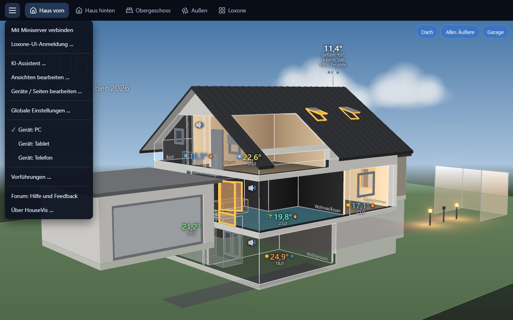
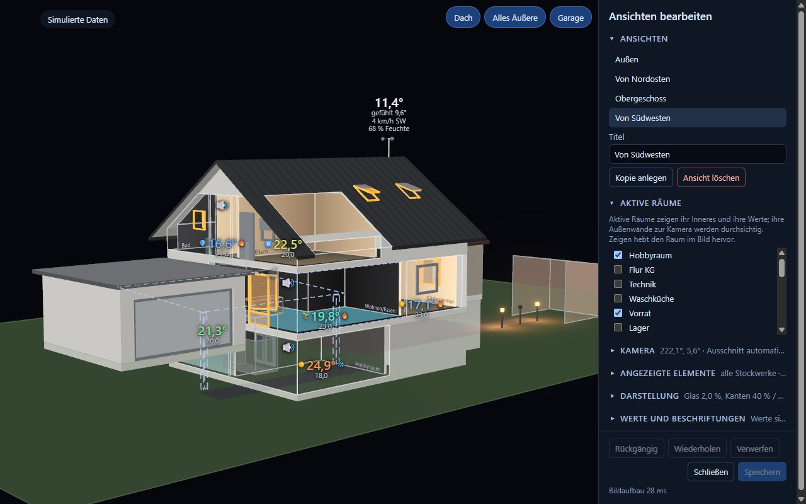
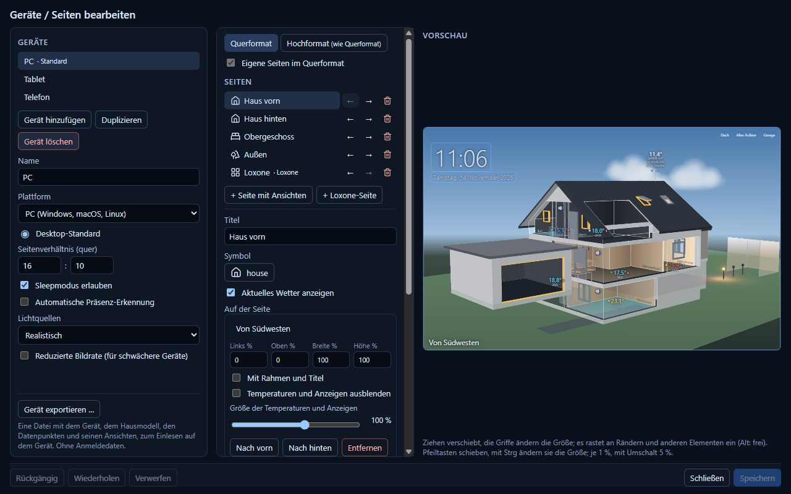
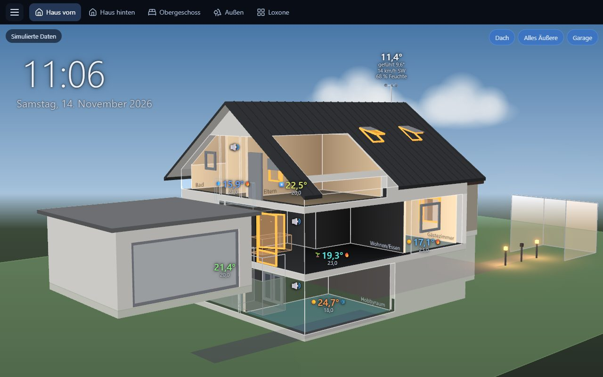
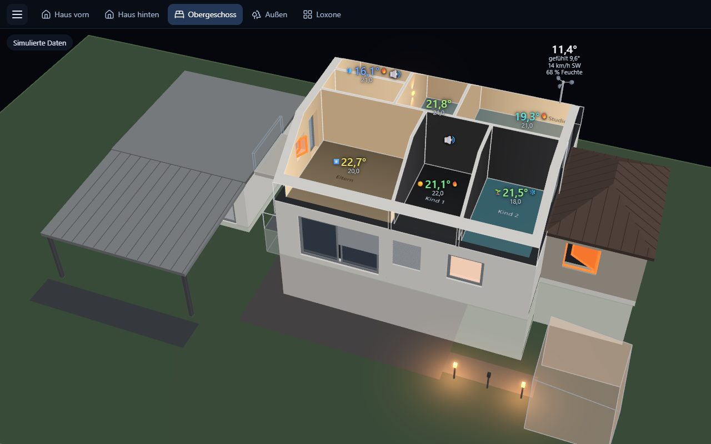
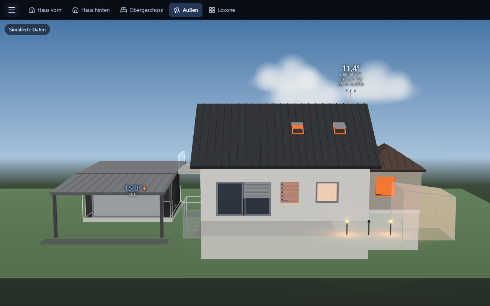

# 3 – Die App benutzen

[← Übersicht](README.md) · [English](../en/3-using-the-app.md)

## Wo was ist

- **Seitenleiste** (oben): ein Knopf pro Seite. Eine Seite zeigt eine oder mehrere Ansichten oder
  die Loxone-Oberfläche.
- **Schalter** (oben im Bild): Teile des Hauses beim Anschauen ein- und ausblenden, z. B. das Dach
  oder alles Äußere.
- **Statusfeld** (oben links): nur wenn die Werte nicht live vom Miniserver kommen (Verbindung
  wird aufgebaut oder ist getrennt, simulierte Daten, Demo).
- **Menü ☰** (oben links):

| Menüpunkt | Wofür |
|---|---|
| Mit Miniserver verbinden | anmelden, Miniserver wechseln |
| Loxone-UI-Anmeldung … | Benutzer und Kennwort der Loxone-Oberfläche speichern, damit sie nach dem Start der App nicht jedes Mal fragt (freiwillig; das Kennwort liegt dann verschlüsselt auf dem Gerät, siehe Hinweis im Dialog; nur bei verschlüsselter Verbindung). Nach dem Speichern zeigt die App die Loxone-Seite und meldet sich gleich an; lehnt Loxone ab, öffnet sich der Dialog wieder mit einem Hinweis |
| KI-Assistent … | das Modell mit Claude ändern ([Kapitel 2](2-hausmodell.md)) und mehr: Vorführungen anlegen, Zuordnungen zu Loxone prüfen |
| Ansichten bearbeiten … | von wo du schaust, welche Räume offen sind, was ausgeblendet ist |
| Geräte / Seiten bearbeiten … | welche Seiten PC, Tablet oder Handy zeigen; pro Gerät auch Lichtquellen (realistisch oder einfach) und reduzierte Bildrate für langsamere Geräte; Export fürs Tablet |
| Globale Einstellungen … | zwei Seiten, links gewählt. **Optionen**: Sprache der App (sonst die des Geräts); Größe der Loxone-Seite (kleiner passt mehr hinein, z. B. für den Ambient-Modus der Loxone-App; Standard 90 %). **Symbole**: das Symbol für Heizung, Musik, … aus drei Sätzen: **Fluent Emoji** (farbig), **Fluent Emoji (High Contrast)** (dieselben einfarbig) und **Lucide** (schlichte Linien); zuerst Vorschläge, sonst nach Gruppe oder mit der Suche, z. B. „Lautsprecher“ oder „Waschmaschine“. Einfarbige Symbole bekommen eine **Farbe** (Standard, eine aus der Palette oder „Eigene …“; Farbe wählen, dann das Symbol). Ein Zustand lässt sich auch ganz ausblenden („Nicht anzeigen“, z. B. pausierte Musik) |
| Konfigurationsordner … | welches Hausmodell die App zeigt |
| Konfiguration laden … | nur Tablet: eine exportierte Datei laden ([Kapitel 1](1-installation.md)) |
| Einstellungen … | nur Tablet: Sprache der App und Größe der Loxone-Seite für dieses Gerät, abweichend von den Globalen Einstellungen |
| Gerät: … | ausprobieren, wie die Seiten eines anderen Geräts aussehen |
| Vorführungen … | was die App von selbst zeigt. **Demo-Haus**: das ausgedachte Haus ansehen; alle Wettertypen nacheinander (Wetter-Demo); ein ganzer Tag in zwei Minuten, die Seiten wechseln von selbst (Vorführung, für einen Bildschirm, der einfach läuft); dazu kurze Filme mit Kamerafahrt (Rundflug, Licht am Abend, …). **Dein Haus**: deine eigenen Vorführungen, die der Haus-Assistent dir anlegt, z. B. „Mach eine Vorführung wie ‚Ein Tag in zwei Minuten‘ für mein Haus“, mit ausgedachten oder mit den aktuellen Werten. Esc oder ein Klick beendet eine Vorführung; „Dauerschleife“ lässt sie endlos laufen. |
| **Forum: Hilfe und Feedback** | öffnet [forum.housevis.de](https://forum.housevis.de) im Browser: Fragen, Fehler melden, Ideen (nur Windows) |

## Ansichten: was du siehst

Eine **Ansicht** ist eine Kameraposition plus die Wahl, was offen ist. **Aktive Räume** sind
aufgeschnitten: du siehst hinein, mit Temperatur, Lichtfarbe und Anzeigen. Alle anderen Räume sind
geschlossene Wände.

Menü → **Ansichten bearbeiten …**, dann:

- **Aktive Räume** – die Räume anhaken, in die du hineinsehen willst. Keiner angehakt: das
  geschlossene Haus von außen.
- **Kamera** – im Bild ziehen dreht, Mausrad zoomt, rechte Maustaste verschiebt.
- **Angezeigte Elemente** – nur einzelne Stockwerke zeigen; bei Gruppen wie Dach oder Garten den
  Haken unter **Anzeigen** entfernen; einer Gruppe einen **Schalter** auf der Seite geben. Eine
  Wand im Bild anklicken, um sie durchsichtig zu machen oder auszublenden. Das **Dach** ist von
  sich aus über den aktiven Räumen offen, soweit es dort ihre Decke bildet (Räume unter einem
  niedrigen Dach, Kniestock); ein Klick aufs Dach macht es durchsichtig, verborgen oder ganz fest.
- **Werte und Beschriftungen** – Temperaturen und Symbole im Bild an ihren Platz ziehen (auch ein
  Symbol an einem eigenen Ort, etwa der Briefkasten an der Haustür; nur für diese Ansicht). Mit
  Umschalt beim Ziehen hebt oder senkt man es; ein Doppelklick setzt es zurück. Den Raumnamen
  zieht man auf eine andere Wand des Raums oder auf seinen Boden – passend für eine Ansicht, die
  von oben auf ein Stockwerk schaut; solche Ansichten legen Namen von selbst auf den Boden, wo
  keine Wand sie gut zeigt.
- **Kopie anlegen** – eine neue Ansicht aus dieser beginnen. Beim ersten **Speichern** (Strg+S)
  fragt HouseVis, ob sie auf jedem Gerät eine eigene Seite bekommen soll. Strg+Z macht rückgängig.

## Seiten und Geräte

Menü → **Geräte / Seiten bearbeiten …**: jedes Gerät (PC, Tablet, Handy) hat seine Seiten. Füge eine
**Seite mit Ansichten** hinzu und platziere eine oder mehrere Ansichten darauf (in der Vorschau
ziehen; die Vorschau zeigt die Ansichten selbst), oder eine **Loxone-Seite** mit der Loxone-Oberfläche. Pro Seite: ihr **Symbol** in der Seitenleiste (aus denselben Sätzen wie die Anzeigen, einfarbige mit Farbe, oder „Kein Symbol zeigen“), **Aktuelles Wetter anzeigen**, dazu **+ Uhr** und
**+ Datum** (platziert und in der Größe geändert wie eine Ansicht, immer vorn; Uhrzeit und langes
Datum mit Wochentag und Monat, so wie die Systemeinstellungen des Geräts sie schreiben, z. B. 12
oder 24 Stunden). Pro Ansicht auf der Seite: **Mit Rahmen und Titel**, **Temperaturen und Anzeigen
ausblenden** (nur das Haus, z. B. für eine kleine Nebenansicht) und **Größe der Temperaturen und
Anzeigen** (30 bis 150 %, Doppelklick auf den Regler: 100 %). Pro
Gerät: **Sleepmodus erlauben** (für Wandtablets aus) und **Automatische Präsenz-Erkennung** (dunkel,
solange niemand im Raum ist; der Bildschirm bleibt dann ohnehin an).
Ein Rechtsklick auf eine Seite kopiert sie auf ein anderes Gerät, ein Rechtsklick auf ein Gerät
alle seine Seiten; hat das Ziel schon eine Seite gleichen Namens, wird nach einer Rückfrage diese
ersetzt.
**Gerät exportieren …** schreibt die Datei fürs Android-Tablet
([Kapitel 1](1-installation.md#android-tablet)).

## Ideen: so kannst du HouseVis nutzen

**Das ganze Haus in 3D** – eine Ansicht von Südwesten mit allen Wohnräumen aktiv, eine zweite
kleine von Nordosten für die Rückseite. Gut als Hauptseite am PC.

**Geschossmodelle** – eine Seite pro Geschoss: eine Ansicht mit nur diesem Stockwerk (**Angezeigte
Elemente**), Dach ausgeblendet, Kamera steil von oben. Liest sich wie ein lebender Grundriss:
welcher Raum warm ist, wo Licht brennt, welches Fenster offen ist.

**Das Haus von außen** – kein aktiver Raum: Fassaden, Dach, Terrasse, Gartenbeleuchtung, das Wetter
über dem Haus. Schön fürs Handy oder als „Gute-Nacht"-Seite, die offene Fenster zeigt.

**Wandtablet** – ein Gerät ohne **Sleepmodus erlauben** und mit **Automatische Präsenz-Erkennung**
(es wird dunkel, wenn der Präsenzmelder niemanden sieht), eine Geschossseite pro Etage und
eine Loxone-Seite zum Schalten.

**Schalter statt vieler Ansichten** – eine Ansicht des ganzen Hauses mit Schaltern für Dach und
Obergeschoss: antippen, und du schaust ins Erdgeschoss.

Weiter: [4 – Probleme lösen](4-probleme-loesen.md)
