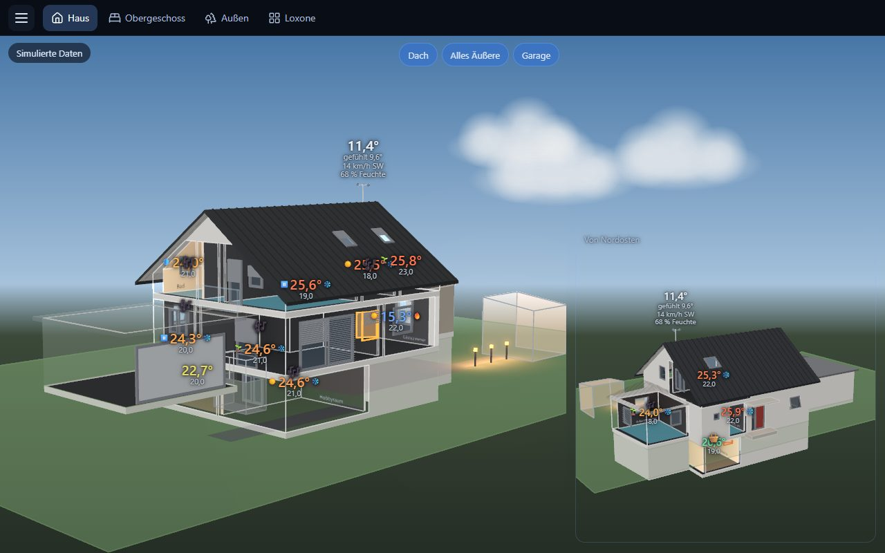

# HouseVis – Anleitung

[English](../en/README.md)

> [!IMPORTANT]
> ### 💬 Das HouseVis-Forum: [forum.housevis.de](https://forum.housevis.de)
>
> Fragen stellen, Hilfe beim Hausmodell bekommen, Fehler melden, Ideen vorschlagen, Neuigkeiten
> erfahren – und während der Beta die Downloads.
>
> [Hilfe](https://forum.housevis.de/c/hilfe) · [Hausmodell & Pläne](https://forum.housevis.de/c/hausmodell) ·
> [Feedback zum Haus-Assistenten](https://forum.housevis.de/c/skill-feedback) · [Fehler melden](https://forum.housevis.de/c/fehlerberichte) ·
> [Ideen](https://forum.housevis.de/c/ideen) · [Beta-Tester werden](https://forum.housevis.de/g/Beta-Tester)

HouseVis zeigt dein Haus in 3D mit Live-Werten aus deinem Loxone Miniserver: Temperaturen,
Licht in seiner echten Farbe, offene Fenster, Beschattung, Präsenz, Heizung, Wetter. Es läuft
unter Windows und auf Android-Tablets.

## Wo finde ich …

| Ich möchte … | Lies |
|---|---|
| HouseVis installieren und mit dem Miniserver verbinden | [1 – Installation und erster Start](1-installation.md) |
| **ein 3D-Modell meines eigenen Hauses bekommen** | [2 – Das Hausmodell erstellen](2-hausmodell.md) |
| Ansichten, Seiten, ein Wandtablet einrichten | [3 – Die App benutzen](3-app-benutzen.md) |
| etwas beheben, das falsch aussieht | [4 – Probleme lösen](4-probleme-loesen.md) |
| **Hilfe bekommen, einen Fehler melden, eine Idee vorschlagen** | **[das Forum: forum.housevis.de](https://forum.housevis.de)** |

## Kurz gesagt

1. HouseVis installieren, mit dem Miniserver verbinden.
2. Claude baut das Modell deines Hauses aus deinen Bauplänen und Fotos. Das ist der eine größere
   Schritt; plane einen Abend (oder mehrere) ein, nicht fünf Minuten.
3. Festlegen, wie du das Haus sehen willst (Ansichten), und die Ansichten auf Seiten für PC und
   Tablet verteilen.

Erst mal schauen? Startbildschirm und Menü bieten **Demo**: ein ausgedachtes Haus mit Live-Werten,
ganz ohne Miniserver.

HouseVis liest nur aus dem Miniserver. Geschaltet wird in der Loxone-Oberfläche, die eine Seite
neben dem Haus zeigen kann.
