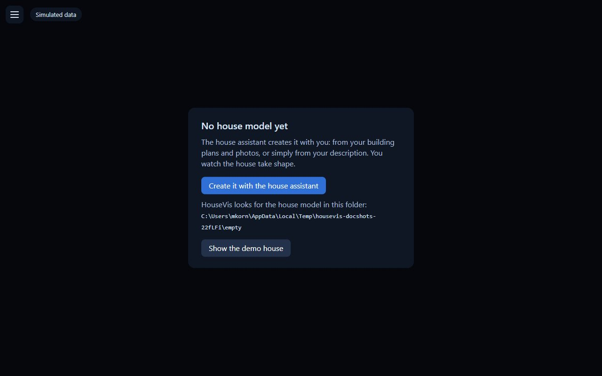
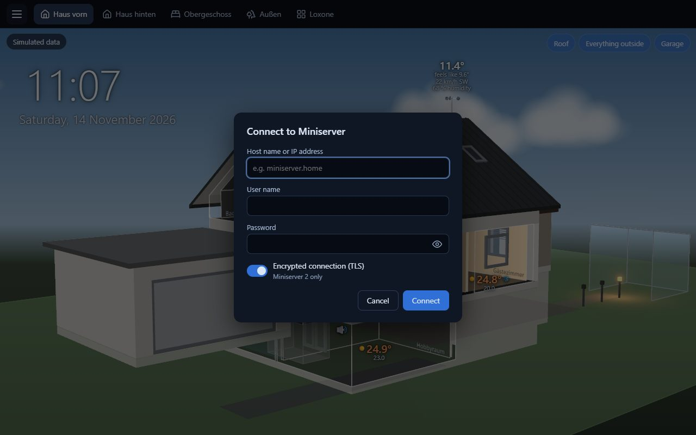

# 1 – Installation and first start

[← Overview](README.md) · [Deutsch](../de/1-installation.md)

> [!IMPORTANT]
> **During the beta, HouseVis is available through the forum.** On
> [forum.housevis.de](https://forum.housevis.de/g/Beta-Tester), ask to join the group **Beta-Tester**. Once you are
> in, the Windows installer and the Android APK are in the category
> [Beta-Programm](https://forum.housevis.de/c/beta-programm).

## Windows

1. Download `HouseVis-Setup-<version>.exe` from the
   [Releases page](https://github.com/Grestorn/HouseVis/releases) and start it.
2. Windows may warn about an "unknown publisher" (the installer is not signed yet): click
   **More info** → **Run anyway**.
3. The installer installs HouseVis for your Windows user only; no administrator rights needed.

**Updating from an older version:** just run the new installer. If the new version needs a newer
format of the house model, it converts your `house.json` itself on its first start; the old file
is kept beside it (e.g. `house.v6.json`). Export files from an older version can still be read in
on the tablet.

## First start

Without a house model HouseVis shows its start screen:

- **Create it with the house assistant** – build the model inside the app (see
  [chapter 2](2-house-model.md), way A).
- **Choose another folder …** – if you already have a model (e.g. one Claude Code built).
- **Show the demo house** – look around first.

The folder shown there (`Documents\HouseVis` by default) is where HouseVis keeps your house
model. You can change it any time in the menu → **Configuration folder …**; the app restarts
with it.

## Connecting the Miniserver

Menu (☰ top left) → **Connect to Miniserver**:

- **Host name or IP address** of the Miniserver, e.g. `192.168.1.10` or its name in your network.
- **User name and password** of a Loxone user. Best: a user of its own (e.g. `housevis`) that may
  see **all rooms** – HouseVis only gets what this user may see.
- **Encrypted connection (TLS)**: on for a Miniserver 2 (Gen. 2), off for the first generation.

HouseVis never stores the password, only a token, encrypted for your Windows user. While the
values come live from the Miniserver, nothing shows top left; a badge appears there only when they
do not ("Connecting to the Miniserver …", "Miniserver disconnected", "Simulated data").

## Android tablet

The tablet shows what you set up on the PC; it has no editors.

1. Install the APK from the [Releases page](https://github.com/Grestorn/HouseVis/releases) (Android asks to allow installing from this source).
2. On the PC: menu → **Edit devices / pages …**, choose the device (e.g. "Tablet"),
   **Export device …**. This writes one `.housevis` file with the model and its pages; no
   sign-in data. The next export offers the same folder again.
3. Get the file onto the tablet (e-mail, cloud, USB) and open it with HouseVis, share it to
   HouseVis, or use the menu → **Load configuration …**. Until the pages are there, the app
   shows "Loading the configuration …"; on a tablet that takes a few seconds.
4. On the tablet: menu → **Connect to Miniserver**.

After changes on the PC, export and read in again.

**Distributing automatically:** a file chosen through **Load configuration …** is watched: when
it changes, the app reads it in again by itself (checked every 30 seconds and when you return to
the app). If the file lies in a folder that a sync app
such as QFile Pro keeps in step with the PC or a NAS, exporting there on the PC is all it takes. A
file that cannot be read in (e.g. still half copied) changes nothing; the app tries again at its
next change. Files shared to HouseVis or opened with it are not watched.

Next: [2 – Creating the house model](2-house-model.md)
