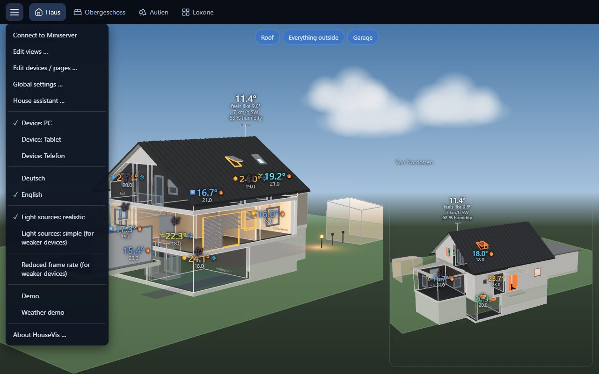
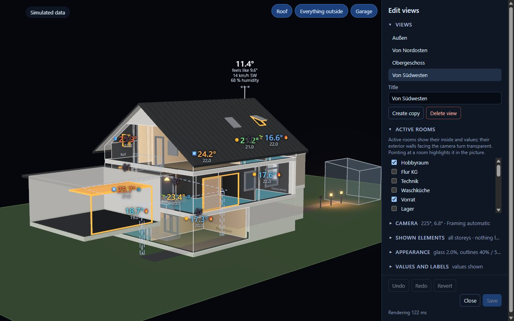
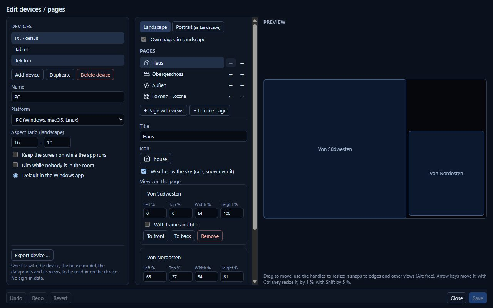
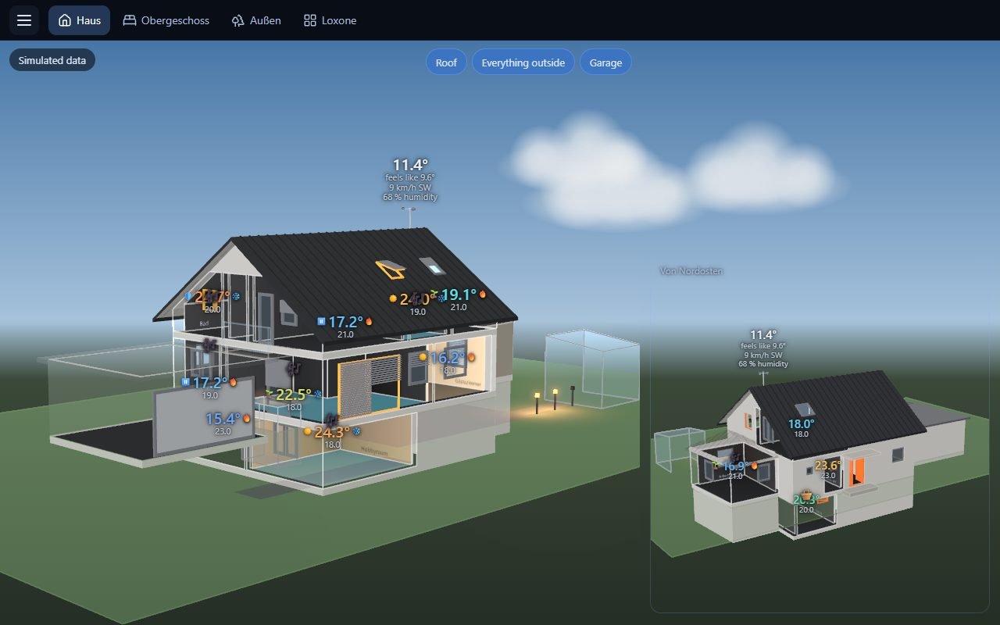
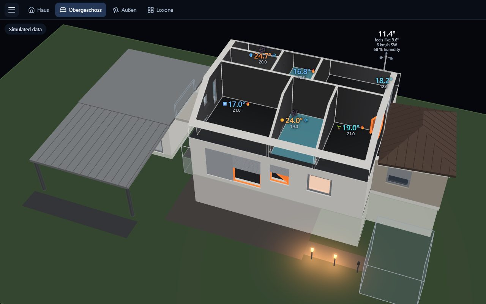
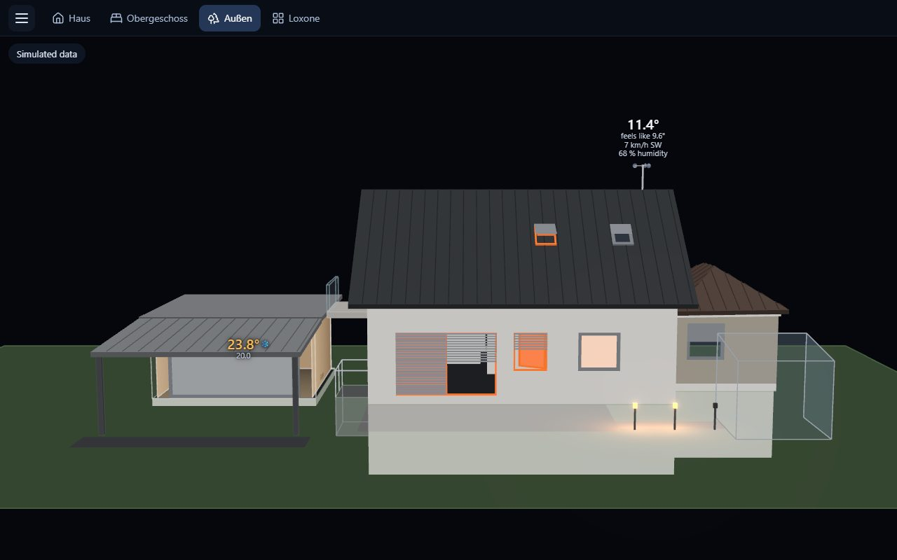

# 3 – Using the app

[← Overview](README.md) · [Deutsch](../de/3-app-benutzen.md)

## Where things are

- **Page bar** (top): one button per page. A page shows one or more views, or the Loxone
  interface.
- **Switches** (top, in the picture): show or hide parts of the house while you look, e.g. the
  roof or everything outside.
- **Badge** (top left): the connection to the Miniserver.
- **Menu ☰** (top left):

| Menu item | What for |
|---|---|
| Connect to Miniserver | sign in, change the Miniserver |
| Edit views … | from where you look, which rooms are open, what is left out |
| Edit devices / pages … | which pages a PC, tablet or phone shows; per device also the light sources (realistic or simple) and a reduced frame rate for slower devices; export for the tablet |
| Global settings … | the app's language (otherwise the device's); icons for heating, music, … (about a thousand: suggestions first, otherwise by group or with the search, e.g. "speaker" or "washing machine"); a state can also be hidden altogether ("Do not show", e.g. paused music) |
| House assistant … | change the model with Claude ([chapter 2](2-house-model.md)) |
| Configuration folder … | which house model the app shows |
| Device: … | test how another device's pages look |
| Demo, Weather demo, Showcase | the made-up demo house; every weather type in turn; a whole day in two minutes with changing weather, the pages turning by themselves (for a video or a screen left running) |
| **Forum: help and feedback (German)** | opens [forum.housevis.de](https://forum.housevis.de) in the browser: questions, bug reports, ideas (Windows only) |

## Views: what you see

A **view** is a camera position plus a choice of what is open. **Active rooms** are cut open:
you see inside, with temperature, light colour and indicators. All other rooms are closed walls.

Menu → **Edit views …**, then:

- **Active rooms** – tick the rooms you want to see into. None ticked: the closed house from
  outside.
- **Camera** – drag in the picture to turn, wheel to zoom, right mouse button to move.
- **Shown elements** – show only some storeys; untick **Show** for groups such as the roof or the
  garden; give a group a **Switch** on the page. Click a wall in the picture to make it
  transparent or hide it.
- **Values and labels** – drag temperatures and icons in the picture to their place.
- **Create copy** – start a new view from this one. **Save** (Ctrl+S); Ctrl+Z undoes.

## Pages and devices

Menu → **Edit devices / pages …**: every device (PC, tablet, phone) has its pages. Add a
**Page with views** and place one or several views on it (drag in the preview), or a **Loxone
page** with the Loxone interface. Per page: **Weather as the sky**. Per device: **Allow sleep
mode** (off for wall tablets) and **Automatic presence detection** (dark while nobody is in the
room; the screen then stays on anyway). **Export device …** writes the file
for the Android tablet ([chapter 1](1-install.md#android-tablet)).

## Ideas: ways to use HouseVis

**The whole house in 3D** – one view from the south-west with all living rooms active, a second
small one from the north-east for the back. Good as the main page on the PC.

**Storey models** – one page per storey: a view with only that storey (**Shown elements**),
roof left out, the camera steep from above. Reads like a live floor plan: which room is warm, where
the light is on, which window is open.

**The house from outside** – no active room: facades, roof, terrace, garden lights, the weather
over the house. Nice for a phone or as a "good night" page that shows open windows.

**Wall tablet** – a device without **Allow sleep mode** and with **Automatic presence detection**
(it goes dark when the presence detector sees nobody), a storey page per floor and a Loxone page
for switching.

**Switches instead of many views** – one view of the whole house with switches for the roof and
the upper floor: tap to look into the ground floor.

Next: [4 – Troubleshooting](4-troubleshooting.md)
