# 3 – Using the app

[← Overview](README.md) · [Deutsch](../de/3-app-benutzen.md)

## Where things are

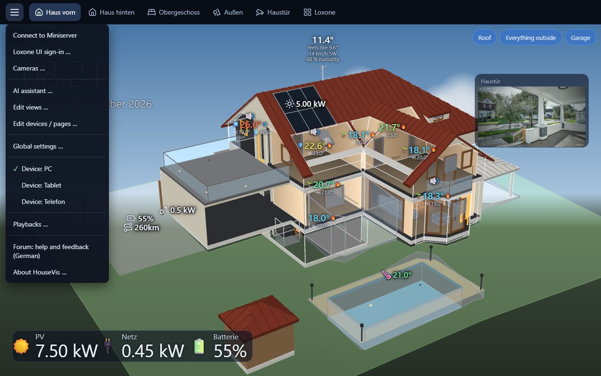

- **Page bar** (top): one button per page. A page shows one or more views, or the Loxone
  interface.
- **Switches** (top, in the picture): show or hide parts of the house while you look, e.g. the
  roof or everything outside.
- **Badge** (top left): only when the values do not come live from the Miniserver (connecting or
  disconnected, simulated data, a demo).
- **Menu ☰** (top left):

| Menu item | What for |
|---|---|
| Connect to Miniserver | sign in, change the Miniserver |
| Loxone UI sign-in … | store the Loxone interface's user and password, so it does not ask after every start of the app (optional; the password then lies encrypted on the device, see the note in the dialog; only with an encrypted connection). After storing, the app shows the Loxone page and signs in at once; if Loxone refuses, the dialog opens again with a note |
| Cameras … | add and set up cameras (Reolink, Loxone Intercom, others), store user and password, look at a test picture ([Cameras](#cameras)); on the tablet only the sign-in |
| AI assistant … | change the model with Claude ([chapter 2](2-house-model.md)) and more: create playbacks, check the mapping to Loxone |
| Edit views … | from where you look, which rooms are open, what is left out |
| Edit devices / pages … | which pages a PC, tablet or phone shows; per device also simple lighting and a reduced frame rate for slower devices; export for the tablet |
| Global settings … | two pages, chosen on the left. **Options**: the app's language (otherwise the device's); size of the Loxone page (smaller fits more in, e.g. for the Loxone app's Ambient mode; default 90 %). **Symbols**: icons for heating, music, … from three sets: **Fluent Emoji** (colour), **Fluent Emoji (High Contrast)** (the same in one colour) and **Lucide** (plain lines); suggestions first, otherwise by group or with the search, e.g. "speaker" or "washing machine". One-colour icons take a **color** (default, one from the palette or "Custom …"; pick the color, then the icon). A state can also be hidden altogether ("Do not show", e.g. paused music) |
| Configuration folder … | which house model the app shows |
| Load configuration … | tablet only: load an exported file ([chapter 1](1-install.md)) |
| Settings … | tablet only: the app's language and the size of the Loxone page for this device, apart from the global settings |
| Device: … | test how another device's pages look |
| Playbacks … | what the app shows by itself. **Demo house**: look around the made-up house; every weather type in turn (weather demo); a whole day in two minutes, the pages turning by themselves (showcase, for a screen left running); and short clips with camera moves (fly-around, lights in the evening, …). **Your house**: your own playbacks, made for you by the house assistant, e.g. “Make a playback like ‘A day in two minutes’ for my house”, with made-up values or the current ones. Esc or a click ends a playback; “Continuous loop” keeps it running. |
| **Forum: help and feedback (German)** | opens [forum.housevis.de](https://forum.housevis.de) in the browser: questions, bug reports, ideas (Windows only) |

## Views: what you see

A **view** is a camera position plus a choice of what is open. **Active rooms** are cut open:
you see inside, with temperature, light colour and indicators. All other rooms are closed walls.

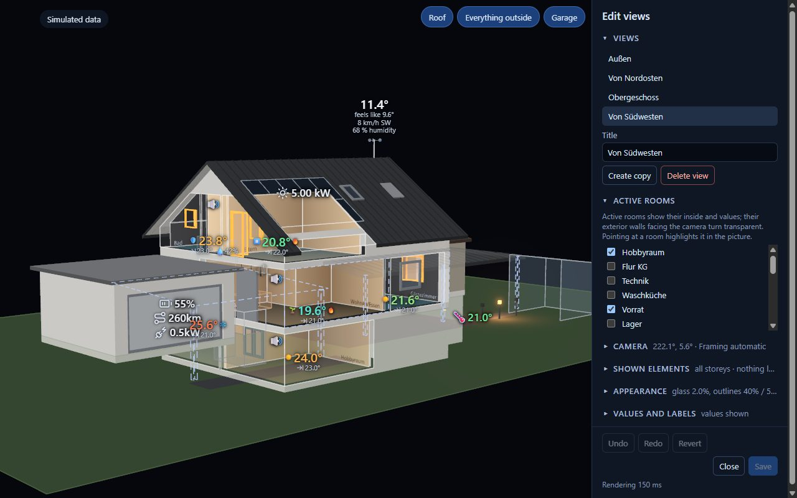

Menu → **Edit views …**, then:

- **Active rooms** – tick the rooms you want to see into. None ticked: the closed house from
  outside.
- **Camera** – drag in the picture to turn, wheel to zoom, right mouse button to move.
- **Shown elements** – show only some storeys; untick **Show** for groups such as the roof or the
  garden; give a group a **Switch** on the page. Click a wall in the picture to make it
  transparent or hide it. The **roof** is open by itself over the active rooms where it is their
  ceiling (rooms under a low roof, knee wall); a click on the roof makes it transparent, hidden
  or fully solid.
- **Values and labels** – drag temperatures and icons in the picture to their place (also an
  icon at a place of its own, like the mailbox at the front door; for this view only). Shift
  while dragging lifts or lowers it; a double-click puts it back. A room's name can be dragged
  onto another wall of the room or onto its floor, which suits a view looking down on a storey;
  such views put names on the floor by themselves where no wall shows them well.
- **Create copy** – start a new view from this one. On its first **Save** (Ctrl+S) HouseVis asks
  whether every device should get a page with it. Ctrl+Z undoes.

## Pages and devices

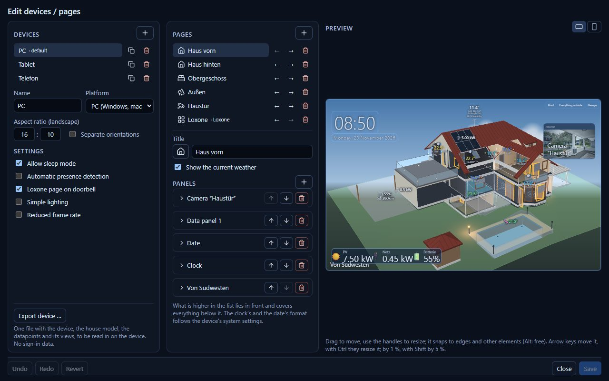

Menu → **Edit devices / pages …**: every device (PC, tablet, phone) has its pages. The **+** beside
**Pages** adds a **HouseVis page** (views, clock, date and data panels, placed in the preview,
which shows the views themselves) or a **Loxone UI** page with the Loxone interface. Per page: the
**Title**, with its icon in the page bar in front of it (a click chooses it from the same sets as
the indicators, one-colour ones with a color, or "Show no icon"), and **Show the current
weather**. The **+** beside **Panels** adds what lies on the page: a **View** (beside it the views
not on the page yet), **Clock**, **Date** (the time and the long date with weekday and month as the
device's system settings format them, e.g. 12 or 24 hours), **Data panel** and **Camera**
([Cameras](#cameras)). Only the chosen
panel is open and marked in the preview; a click on its name opens or closes it. The list is also
the order from front to back: what is higher lies in front and covers everything below it; the
arrows at the top right of each panel move it one layer forward or back, the trash can removes it.

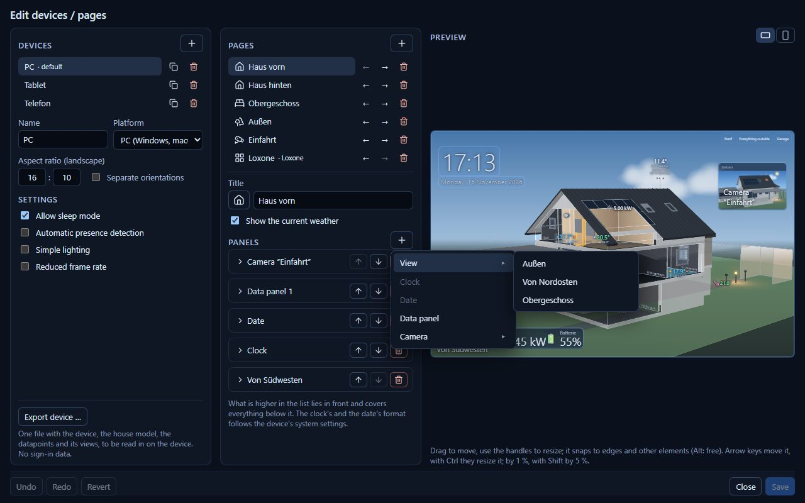

Per view on the page:
**With frame and title**, **Hide temperatures and indicators** (the house alone, e.g. for a small
second view) and **Size of temperatures and indicators** (30 to 150 %; double-click the slider for
100 %).

Per device (the **+** beside **Devices** adds one, the icons in its line duplicate or delete it):
**Name**, **Platform** and **Aspect ratio**. **Separate orientations** gives the device pages of
their own for landscape and portrait (otherwise the same in both); two small icons beside
**Pages** then choose which list you edit, and beside **Preview** you see the page in either
shape. Under **Settings**: **Allow sleep mode** (off for wall tablets), **Automatic presence
detection** (dark while nobody is in the room; the screen then stays on anyway), **Simple
lighting** and **Reduced frame rate** (both for weaker devices). Right-click a device to make it
the **default** (the device the PC shows without a choice of its own) or to copy all its pages to
another device; right-click a page to copy it. Where the target already has a page of the same
name, it is replaced after asking.

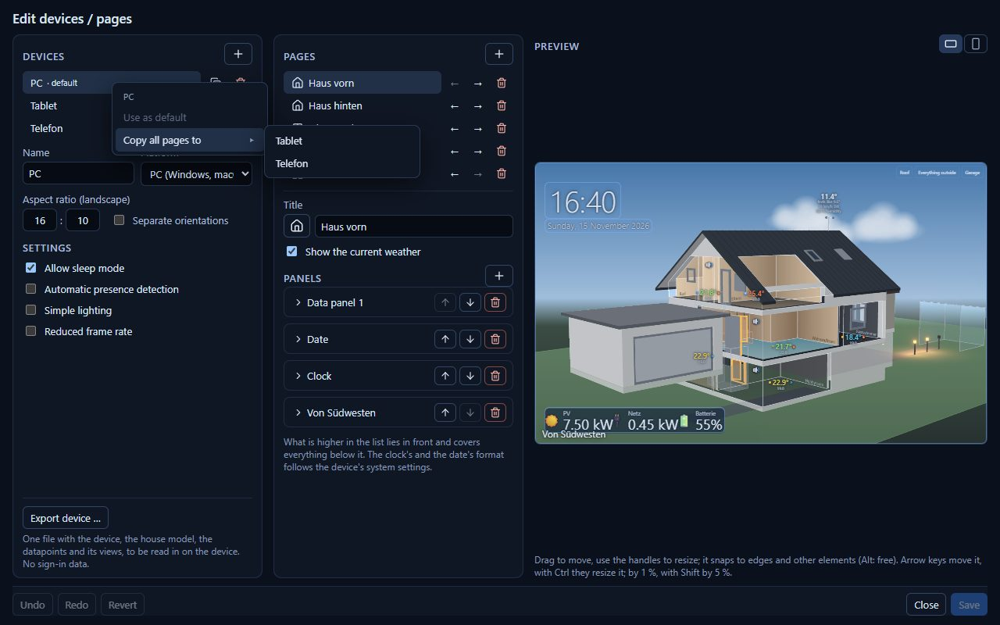
 **Export device …** writes the file
for the Android tablet ([chapter 1](1-install.md#android-tablet)).

### Data panels

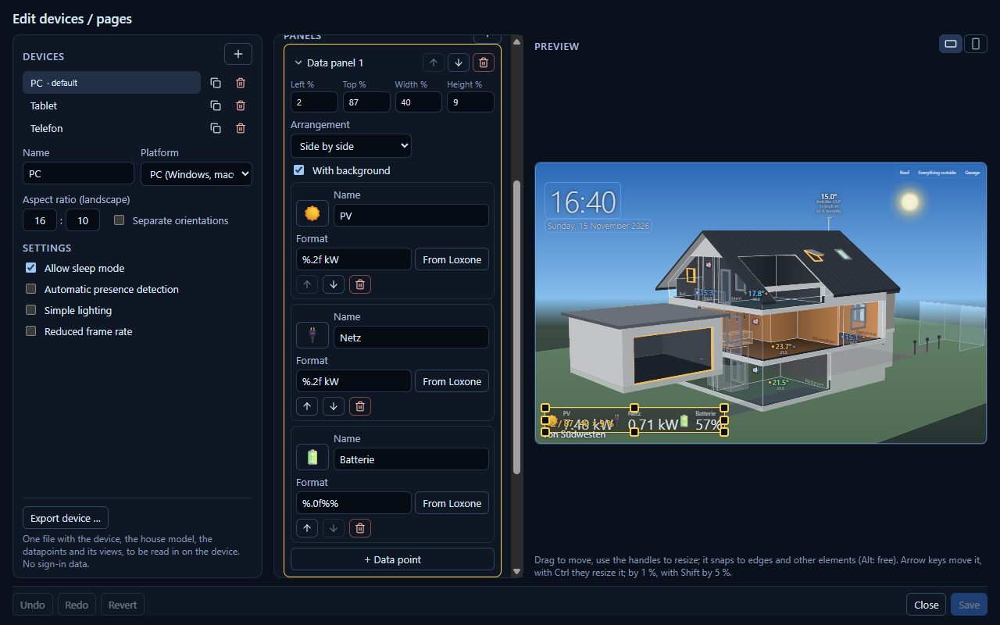

A **data panel** shows any values from Loxone on a page, e.g. the power of the PV system, the power
drawn from the grid or the battery's charge: for each value an icon, a name and the number in the
format Loxone gives for it (e.g. “%.2f kW”). **+** → **Data panel** adds one (in front of everything); it is placed and sized like
the clock, and a page can hold several. Per panel: **Arrangement** (side by side or one below the
other; every value gets the same space, the text as large as fits) and **With background**.
**+ Data point** opens the list of every value of the connected Miniserver, filtered by **Room**
and **Category** and searchable by name, each with its current value:

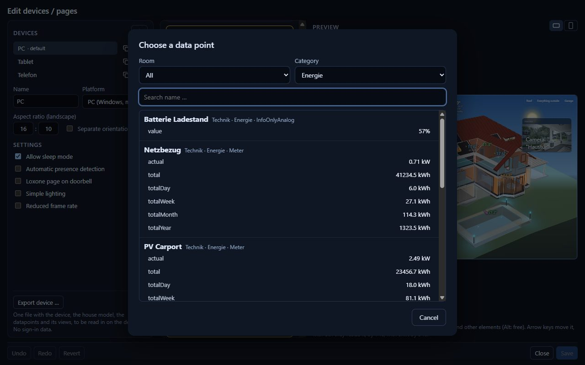

A click takes the value with the block's name, its format and a fitting icon. Everything can be
changed afterwards: the **icon** (or “Show no icon”), the **name** (empty: icon and value alone) and
the **format** (`%.1f` one decimal, `%d` none, `%%` a percent sign, the unit after it; **From
Loxone** fetches it again). The list needs a connection to the Miniserver; it shows only what the
signed-in user may see in Loxone.

### Cameras

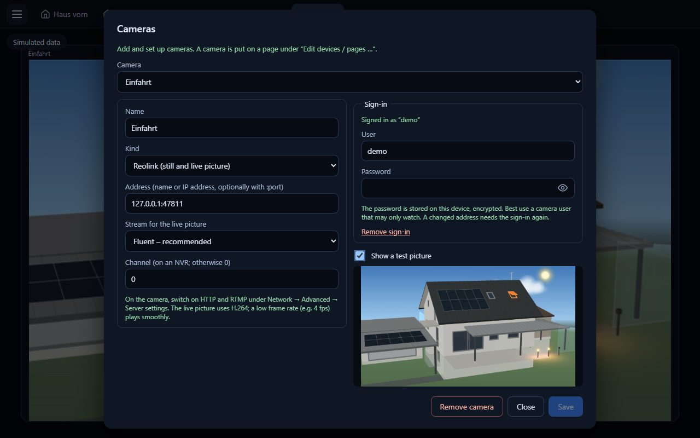

HouseVis shows camera pictures on a page: as a **still picture** renewed every few seconds (beside
the house that is enough and spares the tablet), or as the **live picture**.

**Adding a camera:** menu → **Cameras …** → **New camera …**, give it a **Name** and choose the
**Kind**:

- **Reolink (still and live picture)** – the camera's **Address** (name or IP address, optionally
  with :port). On the camera, switch on **HTTP** and **RTMP** under *Network → Advanced → Server
  settings* and save there; the live picture comes over RTMP, RTSP is not needed. **Stream for the
  live picture**: **Fluent** suits a tablet; *Balanced* is not on every model; *Clear* is the full
  resolution, often in H.265, which not every device plays. For the "Fluent" stream choose H.264
  and a low frame rate in the Reolink app (e.g. 4 fps); that plays smoothly. **Channel** only on a
  recorder (NVR), otherwise 0.
- **Loxone Intercom (through the Miniserver)** – choose the **Intercom** (2nd generation) from the
  list; HouseVis finds it in the Miniserver, no address is needed. The picture comes through the
  Miniserver, encrypted; for that, HouseVis must be signed in with **Encrypted connection (TLS)**.
  It signs in with the user and password of a Miniserver user that may sign in to the intercom (the
  intercom accepts no sign-in without a password).
- **Other camera (still picture only)** – the **Address** and the **Path of the still picture**
  from the camera's manual, e.g. `/cgi-bin/snapshot.cgi?channel=1`.

Under **Sign-in** enter **User** and **Password** and **Save**. The password lies encrypted on this
device and only there: on the tablet, enter it once more under **Cameras …** (the cameras
themselves are there already; they come with the configuration). Best use a camera user that may
only watch. **Show a test picture** shows whether everything is right and fetches a new picture
every few seconds. A camera still on a page cannot be removed; the dialog names the pages.

**Putting it on a page:** menu → **Edit devices / pages …**, at the page **+** → **Camera** → the
camera. Per camera: which **Camera**, **Live picture** (otherwise **Still picture every … seconds**,
30 if not set) and **With frame and title**. The preview always shows a still picture.

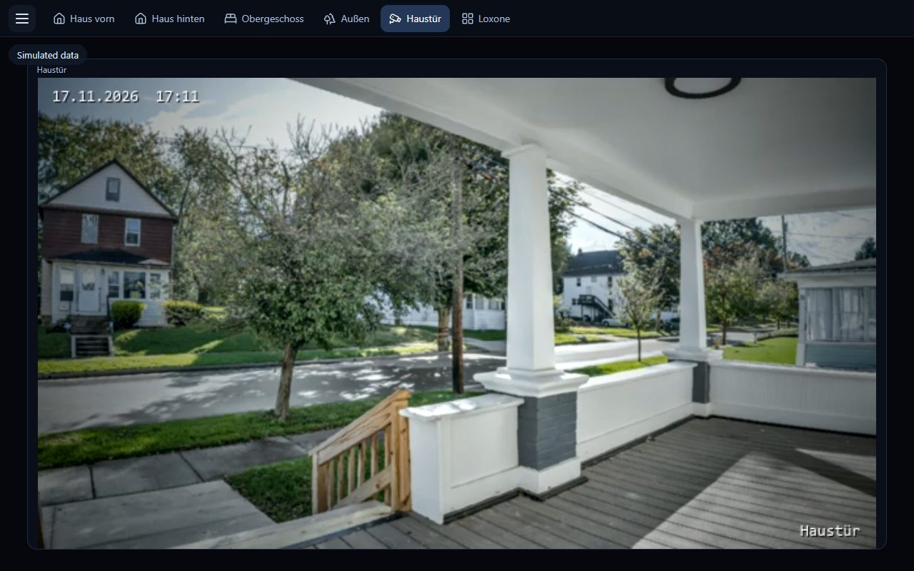

The live picture is best on a page of cameras alone; beside a 3D view a still picture is usually
enough. A live picture is about a second behind reality. To try it, the demo house has a camera
"Einfahrt": small beside the house and live on the page **Einfahrt**.

How to get the Loxone Intercom's picture is documented nowhere by Loxone. It rests on the work of
Markus Laube: [loxone-intercom2](https://github.com/markuslaube/loxone-intercom2). Thank you!

## Ideas: ways to use HouseVis

**The whole house in 3D** – one view from the south-west with all living rooms active, a second
small one from the north-east for the back. Good as the main page on the PC.

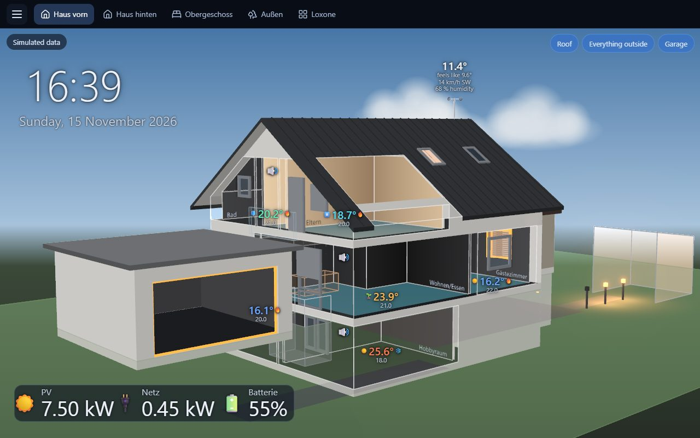

**Storey models** – one page per storey: a view with only that storey (**Shown elements**),
roof left out, the camera steep from above. Reads like a live floor plan: which room is warm, where
the light is on, which window is open.

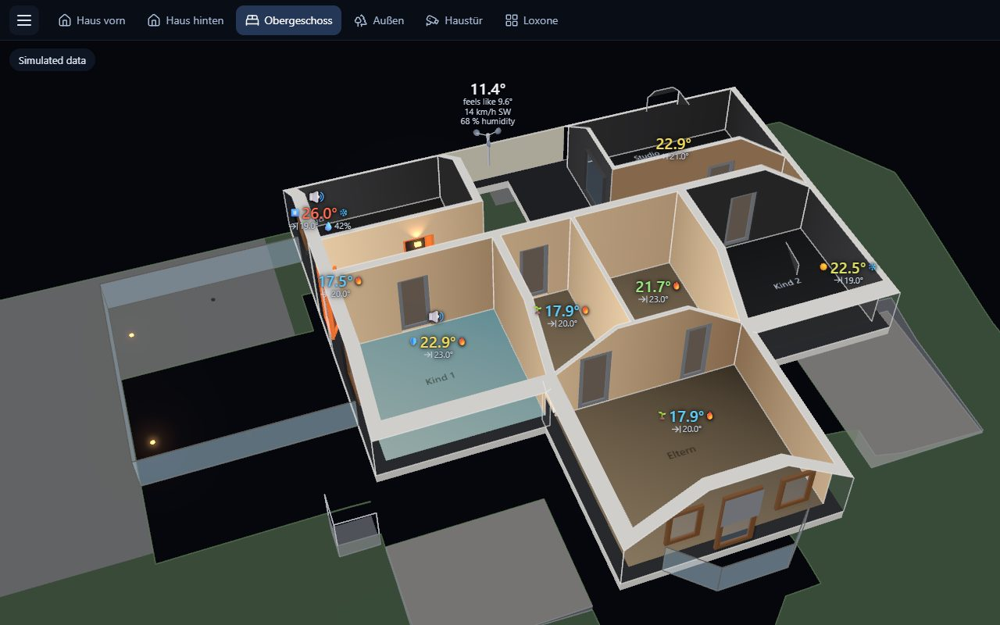

**The house from outside** – no active room: facades, roof, terrace, garden lights, the weather
over the house. Nice for a phone or as a "good night" page that shows open windows.

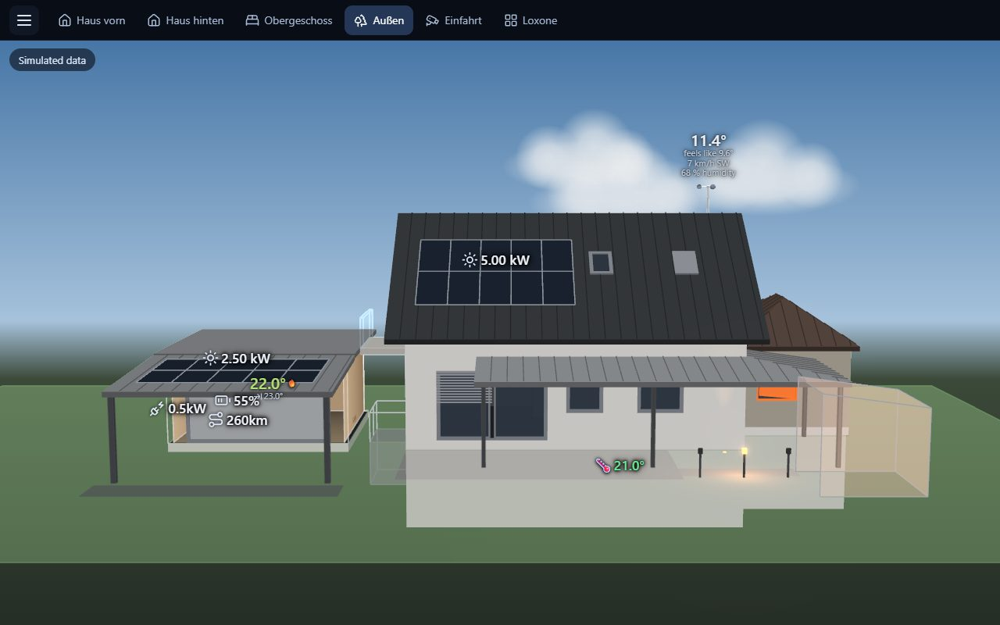

**Wall tablet** – a device without **Allow sleep mode** and with **Automatic presence detection**
(it goes dark when the presence detector sees nobody), a storey page per floor and a Loxone page
for switching.

**Switches instead of many views** – one view of the whole house with switches for the roof and
the upper floor: tap to look into the ground floor.

Next: [4 – Troubleshooting](4-troubleshooting.md)
