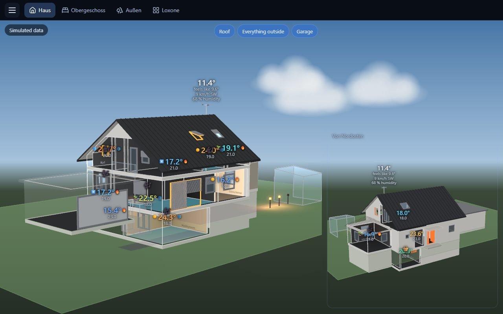

# HouseVis – user guide

[Deutsch](../de/README.md)

> [!IMPORTANT]
> ### 💬 The HouseVis forum: [forum.housevis.de](https://forum.housevis.de) (in German)
>
> Ask questions, get help with your house model, report bugs, suggest ideas, follow the news –
> and, during the beta, download HouseVis.
>
> [Help](https://forum.housevis.de/c/hilfe) · [House model & plans](https://forum.housevis.de/c/hausmodell) ·
> [Feedback on the house assistant](https://forum.housevis.de/c/skill-feedback) · [Report a bug](https://forum.housevis.de/c/fehlerberichte) ·
> [Ideas](https://forum.housevis.de/c/ideen) · [Become a beta tester](https://forum.housevis.de/g/Beta-Tester)

HouseVis shows your house in 3D with live values from your Loxone Miniserver: temperatures,
lights in their real colours, open windows, shading, presence, heating, weather. It runs on
Windows and on Android tablets.

## Where do I find …

| I want to … | Read |
|---|---|
| install HouseVis and connect it to my Miniserver | [1 – Installation and first start](1-install.md) |
| **get a 3D model of my own house** | [2 – Creating the house model](2-house-model.md) |
| arrange views, pages, a wall tablet | [3 – Using the app](3-using-the-app.md) |
| fix something that looks wrong | [4 – Troubleshooting](4-troubleshooting.md) |
| **get help, report a bug, suggest an idea** | **[the forum: forum.housevis.de](https://forum.housevis.de)** (in German) |

## In short

1. Install HouseVis, connect it to your Miniserver.
2. Let Claude build the model of your house from your building plans and photos. This is the one
   bigger step; plan an evening (or a few), not five minutes.
3. Choose how you want to see the house (views), and put the views on pages for your PC and
   your tablet.

Not sure yet? The start screen and the menu offer **Demo**: a made-up house with live values,
no Miniserver needed.

HouseVis only reads from your Miniserver. Switching is done in the Loxone interface, which a
page can show next to the house.
